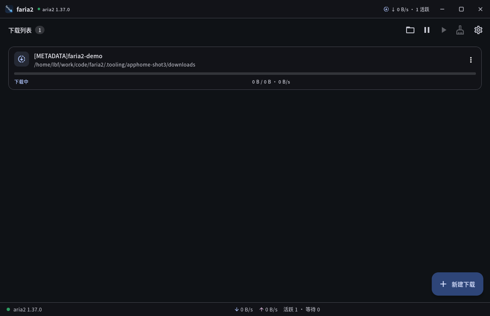

# faria2

faria2 是一个基于 [aria2](https://aria2.github.io/) 的跨平台（Windows / Linux）桌面下载器。



启动 faria2 时会自动准备并启动 aria2c：

1. 先查找设置中手动指定的 aria2c；
2. 再查找系统 `PATH` 中的 aria2c；
3. 再查找 faria2 缓存目录中已安装的 aria2c；
4. 如果都没有（或找到的都无法运行），则按当前操作系统/CPU 架构下载 aria2，
   解压安装到 faria2 的缓存目录，然后启动它。

aria2c 以本地 JSON-RPC 模式运行（仅监听 127.0.0.1，默认使用随机 RPC 密钥），
faria2 通过 RPC 添加任务、显示进度、暂停/继续/删除任务，退出时关闭 aria2c。
RPC 密钥是可选项：可在设置中修改、重新生成或留空关闭认证。

## 功能

- 支持 HTTP / HTTPS / FTP / SFTP / 磁力链接，以及 `.torrent`、`.metalink` 文件
- 任务列表：进度、速度、剩余时间、连接数、错误信息
- 单个任务与全局的暂停 / 继续，清除已完成记录
- 移除任务，可选择同时删除已下载文件
- 下载目录、同时下载数、连接数、分片数、全局限速、RPC 端口与可选 RPC 密钥等设置
- 网络代理开关（默认 `127.0.0.1:7890`）：aria2c 下载与 faria2 自身的 HTTP 请求都走该代理
- BitTorrent Tracker：默认从 ngosang/trackerslist 获取，支持额外订阅链接和手动输入，
  多来源合并去重后应用到种子/磁力下载
- 启动时自动恢复上次的下载会话（aria2 session）
- 跟随系统的浅色/深色主题
- 无系统默认标题栏：自绘标题栏（拖拽移动、双击最大化、最小化/最大化/关闭按钮），
  窗口四边与四角可拖拽缩放
- 系统托盘与后台运行：启动和关闭窗口时都可最小化到托盘，下载继续；托盘菜单可显示窗口、
  全部暂停/继续、打开下载目录、退出，tooltip 实时显示速度与任务数
- 依赖 window_manager 与 tray_manager 两个桌面插件，Windows/Linux 均可直接构建

## 运行机制

| 阶段 | 说明 |
| --- | --- |
| 查找引擎 | 设置路径 → 系统 `PATH` 中的 aria2c → `<缓存目录>/engine/aria2/<版本>/aria2c`；找到但无法运行时会自动跳过，必要时安装托管版本 |
| 自动安装 | Windows 使用 aria2 官方 release 的 zip；Linux 使用 [abcfy2/aria2-static-build](https://github.com/abcfy2/aria2-static-build) 的静态编译 zip |
| 缓存目录 | Linux: `$XDG_CACHE_HOME/faria2`（默认 `~/.cache/faria2`）；Windows: `%LOCALAPPDATA%\faria2\cache` |
| 配置目录 | Linux: `$XDG_DATA_HOME/faria2`（默认 `~/.local/share/faria2`）；Windows: `%APPDATA%\faria2`，保存 `settings.json`、`aria2.session`、`aria2.log` |
| 下载目录 | 默认为系统下载目录下的 `faria2` 文件夹 |
| RPC 端口 | 留空或 0 时优先使用 16800；被占用时自动选择空闲端口，设置页会显示实际端口 |
| RPC 密钥 | 默认随机生成；可在设置中修改或清空。清空后 aria2c 不启用认证（仍只监听 127.0.0.1），密钥变更会自动重启引擎 |

具体版本在 `lib/core/aria2_asset.dart` 中固定为 1.37.0；Windows 上下载官方
`aria2-1.37.0-win-64bit-build1.zip`（32 位系统使用 32bit 包），Linux 按
x86_64 / aarch64 / armv7 / i686 选择对应的静态构建。

## 图标


应用图标由 [design/generate_icons.py](design/generate_icons.py) 生成：深色圆角底板上，
`faria2` 字标沿 45° 斜向排列并作为箭杆，末尾的蓝色箭头尖补足为完整箭头；
没有额外文字，字标本身构成箭头。文字已转换为矢量轮廓，渲染不依赖字体。

- `assets/icons/app_icon.svg`：矢量源文件（512×512）
- `assets/icons/app_icon.png`：512×512 PNG
- `assets/icons/app_icon.ico`：Windows 多尺寸 ICO（256/128/64/48/32/16）
- `assets/icons/tray_icon.png`：64×64 托盘图标

重新生成：

```bash
python3 design/generate_icons.py
```

生成脚本依赖 python3-gi（Pango/Cairo/GdkPixbuf + librsvg）与 ImageMagick。


## 开发

需要 Flutter 3.47+（Dart 3.13+）。本项目使用 Flutter 3.47.7 / Dart 3.13.5 开发。

```bash
flutter pub get
flutter run -d linux     # Linux
flutter run -d windows   # Windows（需在 Windows 上执行）
```

Linux 构建依赖：`clang cmake ninja-build pkg-config libgtk-3-dev liblzma-dev libx11-dev libxi-dev`
（tray_manager 的原生托盘核心需要 X11/Xi 开发文件）。
Windows 构建依赖：Visual Studio 2022（含“使用 C++ 的桌面开发”工作负载）。

## 窗口与托盘

- 窗口使用无边框模式，标题栏由 Flutter 自绘，替代系统默认标题栏。
- 标题栏左侧显示引擎状态与实时速度，右侧是最小化/最大化/关闭按钮；
  双击标题栏可最大化/还原，拖动标题栏可移动窗口。
- 默认在启动时最小化到系统托盘，不显示主窗口；可在设置 → 窗口与托盘中关闭。
  如果托盘不可用，启动时会自动显示窗口，避免无法操作。
- 默认在关闭窗口时最小化到系统托盘（可在设置 → 窗口与托盘中关闭）。
  隐藏到托盘后 aria2c 继续在后台下载。
- 右键托盘图标打开菜单：显示、添加下载、全部暂停/继续、打开下载目录、退出；
  Windows 下左键单击托盘图标可切换窗口显示，tooltip 实时显示速度与任务数。
- “添加下载”会先显示主窗口，再打开“新建下载”对话框。
- 托盘图标不可用（例如 Linux 上没有 D-Bus 会话，或 GNOME 未启用
  AppIndicator 扩展）时，faria2 会自动回退为“关闭窗口即退出”。

## 网络代理与 BitTorrent Tracker

### 网络代理

- **设置 → 网络代理** 打开开关即可启用，默认地址为 `127.0.0.1:7890`，可改成
  `host:port` 或 `http://host:port`。
- 启用后 aria2c 使用 `--all-proxy`，faria2 下载 aria2 引擎和 Tracker 列表的请求也走代理；
  系统里的 `all_proxy/http_proxy` 等环境变量会被忽略，避免与设置冲突。
- 暂不支持 SOCKS 代理和需要用户名/密码的代理。代理设置变更后引擎会自动重启。

### BitTorrent Tracker

- 默认订阅（始终启用）：
  - `https://cdn.jsdelivr.net/gh/ngosang/trackerslist@master/trackers_best.txt`
  - `https://cdn.jsdelivr.net/gh/ngosang/trackerslist@master/trackers_all.txt`
- 可以在设置中添加额外的 http/https 订阅链接，链接需要返回“每行一个 tracker”的文本。
- 也可以手动输入 tracker（每行一个）。手动输入单独保存，会与订阅结果**合并后去重**，
  不会覆盖、删除或影响订阅链接获取到的 tracker。
- 启动时自动获取一次；合并结果通过 aria2 的 `bt-tracker` 全局选项应用，
  添加种子/磁力链接时也会带上当前 tracker 列表。设置页可查看合并数量并手动刷新。

## 外部程序连接 RPC

faria2 只让 aria2c 监听 `127.0.0.1`。RPC 端口留空或设为 0 时，优先使用 **16800**；
如果 16800 已被占用，会自动选择空闲端口。实际端口、WebSocket/HTTP 地址和
RPC 密钥都可以在 **设置 → aria2 引擎** 中查看，并用“复制连接信息”一键复制。

- WebSocket：`ws://127.0.0.1:<端口>/jsonrpc`
- HTTP：`http://127.0.0.1:<端口>/jsonrpc`

aria2 原生支持在同一端口上通过 WebSocket 或 HTTP 调用 JSON-RPC。
如果启用了 RPC 密钥（默认随机生成），调用时必须在 JSON-RPC 的 `params`
首位带上 `token:<密钥>`；如果其他软件不支持密钥，可在设置中把
“RPC 密钥”留空并保存，此时不需要 token（RPC 仍只监听本机）。

## 构建与发布包

```bash
flutter build linux --release
flutter build windows --release   # 在 Windows 上执行
```

产物分别在 `build/linux/x64/release/bundle` 与 `build/windows/x64/runner/Release`。
把整个 bundle/Release 目录一起分发即可，aria2 会在首次运行时自动安装到用户缓存目录。

### 一键打包

Linux：

```bash
./scripts/build_linux_release.sh
```

Windows（PowerShell）：

```powershell
.\scripts\build_windows_release.ps1
```

生成（版本号来自 `pubspec.yaml`，构建号 `+N` 会被去掉）：

- `dist/faria2-1.0.1-linux-x64.tar.gz`（arm64 上为 `dist/faria2-1.0.1-linux-arm64.tar.gz`）
- `dist/faria2-1.0.1-windows-x64.zip`

压缩包内顶层目录为 `faria2/`，解压后运行 `faria2/faria2` 或
`faria2\faria2.exe`。详细依赖与用法见 [scripts/README.md](scripts/README.md)。

### GitHub Actions 自动发布

只有推送 `v*` 标签（例如 `v1.0.1`）才会自动构建：在 Ubuntu 与 Windows 上
分别生成带版本号的压缩包（如 `faria2-1.0.1-linux-x64.tar.gz`、
`faria2-1.0.1-windows-x64.zip`），并创建对应的 GitHub Release。
`main` / `master` 的普通提交不会触发工作流。也可以在
**Actions → Build release → Run workflow** 手动触发，构建完成后从该次运行的
Artifacts 下载压缩包（不会创建 Release）。

## 测试

```bash
flutter analyze
flutter test
```

包含真实 aria2 安装/启动/下载/关闭的端到端测试（会联网下载 aria2）：

```bash
FARIA2_INTEGRATION=1 flutter test test/engine_integration_test.dart
```

## 目录结构

```
lib/
  main.dart                    应用入口
  app.dart                     启动流程（路径、设置、引擎、生命周期）
  core/
    app_paths.dart             缓存/配置/下载目录
    app_settings.dart          设置持久化
    aria2_asset.dart           各平台 aria2 下载源解析
    aria2_locator.dart         查找 aria2c（设置/PATH/缓存）
    aria2_version.dart         locale 无关的 aria2c 版本探测
    aria2_installer.dart       下载、解压、校验并安装 aria2c
    aria2_process.dart         启动/停止 aria2c 进程与日志
    aria2_rpc.dart             aria2 JSON-RPC 客户端
    engine_controller.dart     引擎生命周期状态机
    download_manager.dart      任务轮询与操作
    download_client.dart       带进度的 HTTP 下载
    network_proxy.dart         网络代理配置与 HTTP 客户端
    tracker_service.dart       Tracker 订阅获取、合并与去重
    license_info.dart          MIT 许可证注册
    tray_service.dart          系统托盘图标与菜单
    platform_launcher.dart     打开文件/文件夹
    formatting.dart            大小/速度/时间格式化
    models/                    任务与全局状态模型
  ui/                          主界面、设置、添加任务、控件
    window/                    无边框标题栏、窗口缩放、WindowShell
assets/icons/                  应用图标（SVG/PNG/ICO）
design/generate_icons.py       图标生成脚本
scripts/                       本地 Linux/Windows 发布打包脚本
.github/workflows/             GitHub Actions 自动构建与发布
test/                          单元测试与端到端测试
LICENSE                        MIT 许可证
```

## 常见问题

- **提示无法连接 aria2 / 启动失败**：在设置页点击“查看日志”，
  日志文件位于配置目录的 `aria2.log`，其中包含 aria2c 的 stderr 输出。
- **系统设置了 `all_proxy=http://…` / `all_proxy=socks5://…` 之类代理变量**：
  faria2 启动 aria2c 时会移除全部代理环境变量，代理完全由 **设置 → 网络代理** 控制，
  避免系统变量与应用设置冲突。如需代理请打开开关并填写 `host:port` 或
  `http://host:port`（不支持 SOCKS 与认证代理）。
- **启动后看不到窗口**：默认启动时最小化到托盘，右键托盘图标选“显示”即可；
  托盘不可用时会自动显示窗口。可在设置 → 窗口与托盘中关闭
  “启动时最小化到系统托盘”。
- **Windows 下“打开文件 / 打开所在文件夹”无效**：已改为通过 `cmd.exe`
  调用 `start` / `explorer /select,"<路径>"`，避免直接启动 explorer 时
  `/select` 参数丢失。
- **托盘图标不显示 / 关闭窗口直接退出**：Linux 上托盘使用 StatusNotifierItem，
  GNOME 需要安装并启用 AppIndicator 扩展（Ubuntu 默认开启），且需要 D-Bus 会话；
  托盘不可用时 faria2 会自动回退为关闭即退出。
- **Linux 下无边框窗口无法拖动或缩放**：X11 下可直接拖动标题栏、拖拽窗口边缘；
  Wayland 下窗口移动/缩放由合成器控制（例如 KDE 下可用 Super + 拖动移动窗口）。
- **系统安装的 aria2c 无法运行**（例如缺少动态库、权限问题或版本过旧）：
  faria2 会用 `aria2c --version` 逐个探测候选，跳过无法运行的版本，
  必要时自动安装托管版本；被跳过的路径会显示在设置页的“aria2 引擎”中。
- **无法联网下载 aria2**：在设置中手动指定系统中已有的 aria2c
  （例如通过包管理器安装的），faria2 会直接使用它，不再下载。
- **换一台机器或清理缓存后**：删除缓存目录中的 `engine` 文件夹，
  或在设置中点击“重新安装 aria2”，下次启动会重新下载。

## 许可证

faria2 自身代码使用 **MIT** 许可证（见 [`LICENSE`](LICENSE)）。
应用内可在 **设置 → 关于 → 开源许可** 查看完整 MIT 文本与第三方依赖许可。
aria2 是 GPLv2 软件，由 faria2 在运行时从官方发布渠道下载，不会随应用一起分发。
